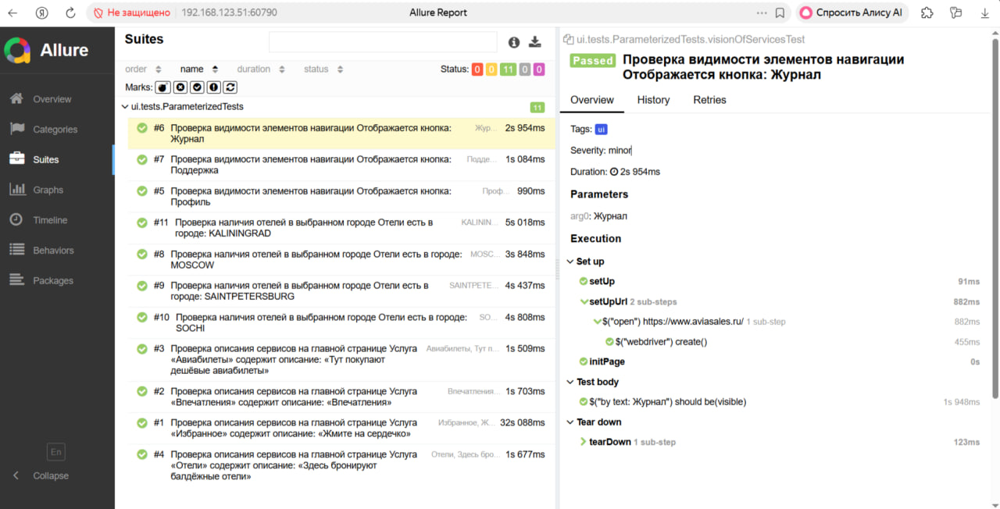

🛫 Aviasales UI & API Tests

Репозиторий содержит тесты для веб-интерфейса и API Aviasales, а также конфигурацию Jenkins Pipeline для запуска в CI

Мобильные тесты вынесены в отдельный репозиторий: [MOBILEREST](https://github.com/H1ghOctane/MOBILEREST) (тестирование Wikipedia через Appium/BrowserStack)

✅ Стек
- Java 17
- Gradle
- JUnit 5
- Selenide
- REST Assured
- Owner
- Lombok
- AssertJ
- Allure Report
- Jenkins

📸 Визуализация тестов

### Allure-отчет (UI)

### Успешная сборка в Jenkins (API)

